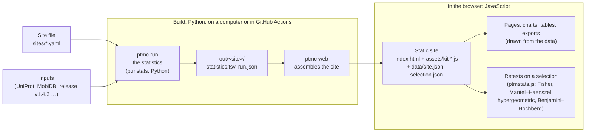

# ptmcontext (working name; `ptmcontext` proposed)

Where do modifications fall in proteins, tested fairly? One reference proteome, any mark (methylarginine,
phosphosites, methyllysine ...), any regions (disorder, IDRs, domains, motifs, a lab's own), and two tests for every
class: **pooled** (Fisher) and **within protein** (Mantel–Haenszel, each protein a stratum), written in the statistics
table of the Methylarginine Site Explorer's releases.

A site is a YAML file. Changing the mark, the organism or the analyses is changing the file:

```bash
pip install -e ".[test]"
ptmc stage uniprot UP000002311 --out DATA/inputs --manifest sites/yeast_phospho.inputs.json --prefix yeast
ptmc stage mobidb --out DATA/inputs --manifest sites/yeast_phospho.inputs.json --prefix yeast
ptmc stage shephard s_cerevisiae --out DATA/inputs --manifest sites/yeast_phospho.inputs.json --prefix yeast
ptmc run sites/yeast_phospho.yaml --root DATA          # -> out/yeast_phospho/statistics.tsv and run.json
ptmc web sites/yeast_phospho.yaml                      # -> out/yeast_phospho/web/: the site, in the Methylarginine Site Explorer's look
```

## How the site is built

Two languages, one split: **Python builds, JavaScript shows.** No Python runs in the browser, and the published site is
static files (GitHub Pages only serves them; there is no server).



- **The release's statistics** are computed once, in Python, at build time (`ptmc run`), and checked row for row
  against release v1.4.3 (`tests/test_parity_v1_4_3.py`). The browser only displays them.
- **The site** is assembled by `ptmc web` from the site file: the HTML shell, the browser kit
  (`ptmcontext/web/assets/kit-*.js`, one module per feature, loaded in the order of `MODULES` in
  `ptmcontext/web/__init__.py`) and the data, split so the first screen loads fast (`data/site.json` and
  `selection.json` follow when needed).
- **Retests in the browser.** When a reader makes a selection, the Overview's tests, "What sets it apart?" and the
  gene-list test run again in JavaScript with `packages/ptmstats/ptmstats/ptmstats.js`, the same tests as the Python
  package. `packages/ptmstats/tests/test_parity_js.py` runs both on random tables (Fisher, Mantel–Haenszel with its
  confidence interval, hypergeometric, Benjamini–Hochberg) and checks they equal each other and SciPy / statsmodels.
- **One site file per site.** The methylarginine and yeast sites share every line of code; what differs (words,
  colors, questions, filters, features) is in `sites/*.yaml`, validated by `ptmcontext/schemas/site.schema.json`.

## Status (pilot)

- **Parity:** `sites/methylarginine.yaml` rebuilds 4,342 of the 4,659 rows (93%) of release v1.4.3's statistics table
  byte for byte, from the release's inputs, without running any of its code (`tests/test_parity_v1_4_3.py`):
  - the 86 residue-level rows (motif, disorder, domain context, domain class, structure context, and changes at
    methylarginines in TCGA tumors and DepMap cell lines, counted on the proteins whose gene DepMap screened; pooled
    and within protein);
  - the 4,256 protein-set rows for PANTHER protein classes (grouped, top level, subclasses), Reactome top-level groups,
    Reactome pathways, HPA locations, the DisGeNET disease families, audited and additional (Entrez genes, each
    protein's through its UniProt gene name; the families from the release's rules, `sites/data/`), CD-CODE's
    human condensates against the proteome and against the other condensate proteins (members kept by CD-CODE's
    protein and condensate tables, old accessions through UniProt's history), the maps of the cell (Human Cell Map
    compartments and domains, organelle IP, chromatin probability, and the regions of the cell in three maps) and
    DepMap dependency classes (clusterProfiler's `enricher`, rewritten in Python, and its repeat within PaxDb
    abundance deciles).

  The rest (317 rows: functional classes, sequence proximity, crosslinks, interfaces, GO and experimental RNA and DNA
  binding, eCLIP, the nuclear-body proteomes) come next, one parity check at a time.
- **A new question, from one new layer:** `idr_charge` places each residue by the charge of the IDR it sits in, the
  region of the Das–Pappu diagram of states (CIDER's FCR, NCPR and κ, written out from the papers in
  `ptmcontext/charge.py`). One line adds it to a site (`new: true` where the site has a reference: it is not checked
  against the release, and the website marks it new). Within each protein, methylarginines sit 3.3× more often than
  other arginines in weakly charged IDRs (FCR < 0.25) and less often in strongly charged ones; yeast phosphosites go
  the other way, from 1.8× in weakly charged IDRs to 4.4× in negatively charged ones.
- **Domain sources compared:** `sites/methylarginine_interpro_ecod.yaml` fills the proteins InterPro leaves without
  domains with SHEPHARD's ECOD domains (sites without domain data 1,579 → 754); every domain result of the release
  holds.
- **A second organism by configuration:** yeast phosphosites staged from UniProt 2026_03, MobiDB and SHEPHARD in
  about 50 s and run in 21 s. UniProt's domain features cover 1,937 of 6,067 yeast proteins; SHEPHARD's ECOD domains
  fill 2,506 more, so 79% of the phosphosites (4,702 of 5,930) are on a protein with domain data, up from 47%.
- **A website per site, from its file:** `ptmc web` gives the Methylarginine Site Explorer's look with the site's own
  colors, pictures and words; every figure and table downloads as PDF, SVG, PNG and TSV carrying its description,
  citation (from the site's `CITATION.cff`), versions and provenance. As in the explorer:
  - **Overview:** tiles that open with each question's most telling classes (which tiles, in which sections:
    `website.overview`), each opening to its full figure.
  - **Sections and Filters:** a sidebar whose filter groups come from the site file (`website.filters`): the
    questions' classes and the marks' own attributes (`marks.attributes`: a state, the studies that report a mark
    with their DOIs, ...). A selection is kept in the link, and the Overview's tests run again on it in the browser
    (within-protein Mantel–Haenszel, pooled Fisher, hypergeometric), computed as the site's own rows.
  - **Proteins and Sites:** tables of the selection; each site's studies linked to their papers.
  - **Highlight and figures:** a pasted list of genes or sites (`hl=` in the link) is ringed in every figure that plots
    items and narrows nothing; every table has PDF, SVG and PNG beside its TSV; a map of the cell opens large, with zoom
    and the proteins of a part. The site file words its input examples (`website.placeholders`) and can switch the 3D
    viewer, the highlight and the table figures off (`website.features`).
  - **Protein pages:** UniProt's other names and function (live), the map (marks stacked and colored by any
    attribute, labeled Auto/All/None; rows from the site's data, the sequence (charge, hydropathy, aromatic
    residues) and live sources (UniProt regions, variants, PTMs; AlphaFold pLDDT), each item with a hover saying what
    it is and where it comes from and a click that pins it with its links), a card per site with its evidence, and
    live cards from AlphaFold DB, PDBe and STRING.
- **Not built yet:** isoform placement, measured backgrounds, the release writer, the remaining 481 rows. See
  [ARCHITECTURE.md](ARCHITECTURE.md) for how the pieces fit and what is not built yet.

## Publishing

`.github/workflows/pages.yml` builds every site from its sources on each merge to `main` and publishes them with a
landing page on GitHub Pages (Settings → Pages → Source: GitHub Actions). By hand:

```bash
ptmc pages sites/methylarginine.yaml sites/yeast_phospho.yaml --out _site   # after ptmc run and ptmc web for each
```

## Read next

| | |
|---|---|
| [ARCHITECTURE.md](ARCHITECTURE.md) | the pieces and the rules they enforce |
| [CONTRACTS.md](CONTRACTS.md) | the seven file formats |
| [ADDING_DATA.md](ADDING_DATA.md) | adding a source, a mark or a site: a step-by-step guide written for AI agents |
| [AGENTS.md](AGENTS.md) | the rules for anyone, human or AI, changing this repository |

## License

Code: MIT ([LICENSE](LICENSE)). Inputs keep their sources' terms, recorded in each manifest; this repository
redistributes no input data.
