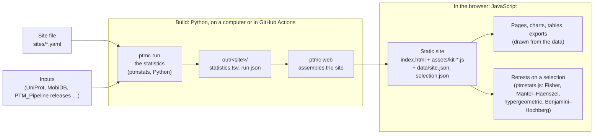

# ptmcontext

ptmcontext tests which human proteins carry a post-translational modification, and which regions, domains, motifs
and neighboring modifications its sites are enriched in. Every test runs two ways: across all proteins (Fisher's
exact test) and within each protein (Mantel–Haenszel, comparing each site with the other residues of its own
protein). Python computes the statistics and builds the site. JavaScript displays them. The published sites are static files on GitHub Pages.

## Sites

Landing page: <https://shechterlab.github.io/ptmcontext/>

| Site | Address |
|---|---|
| Human methylarginine sites | <https://shechterlab.github.io/ptmcontext/methylarginine/> |
| Human methyllysine sites | <https://shechterlab.github.io/ptmcontext/methyllysine/> |
| Human phosphosites | <https://shechterlab.github.io/ptmcontext/phospho/> |

The methylarginine site rebuilds the statistics of release v1.4.3 of the
[Methylarginine Site Explorer](https://github.com/Shechterlab/PTM_Pipeline) without running its code.
`tests/test_parity_v1_4_3.py` checks that 4,549 of the release's 4,659 rows are reproduced exactly.
The methyllysine and phosphosite sites have no earlier release, so all their statistics are new. Each site also shows the
other modifications on each protein and tests whether its sites are within 10 residues of them. Each site's Methods page
describes its inputs, tests and caveats.

`sites/yeast_phospho.yaml` is the same code on another organism. It is not published.

## Data

Every input is in a manifest with its source, release and MD5. Staging is the only step that uses the network.
The sites read releases of [PTM_Pipeline](https://github.com/Shechterlab/PTM_Pipeline) pinned by commit: v1.4.3 for
methylarginine, and v1.5.0 for methyllysine, phosphorylation, acetylation and other acylations, ubiquitination and
SUMOylation. The v1.5.0 tables come from UniProt, iPTMnet, CPLM 4.0, Berryhill et al. 2023 and Ochoa et al. 2020. CPLM
4.0 states no license. Its human lysine methylation and ubiquitination sites are included and cited.

## Build a site

Each site is defined only by YAML files: a site file `sites/<site>.yaml`, a mark file `sites/marks/<mark>.yaml`, an inputs
manifest `sites/<site>.inputs.json` and art in `sites/art/`. `ptmcontext/` contains no site-specific code;
`tests/test_no_site_literals.py` enforces it. For the methyllysine site, with a checkout of PTM_Pipeline at the commit
`.github/workflows/pages.yml` pins in `DATA`:

```bash
pip install -e ".[test]"
ptmc run sites/methyllysine.yaml --root DATA     # out/methyllysine/statistics.tsv and run.json
ptmc web sites/methyllysine.yaml                 # out/methyllysine/web/
```

For a new organism, stage the inputs first, as for the yeast site:

```bash
ptmc stage uniprot UP000002311 --out DATA/inputs --manifest sites/yeast_phospho.inputs.json --prefix yeast
ptmc stage mobidb --out DATA/inputs --manifest sites/yeast_phospho.inputs.json --prefix yeast
ptmc stage shephard s_cerevisiae --out DATA/inputs --manifest sites/yeast_phospho.inputs.json --prefix yeast
```

## How the site is built



The statistics are computed once, at build time. When a reader makes a selection, the browser reruns the tests with
`packages/ptmstats/ptmstats/ptmstats.js`. `packages/ptmstats/tests/test_parity_js.py` checks that it agrees with the
Python package, SciPy and statsmodels on random tables.

## Publishing

`.github/workflows/pages.yml` builds every site on each push to `develop` or `main` and publishes them with a landing page on
GitHub Pages (Settings → Pages → Source: GitHub Actions). By hand:

```bash
ptmc pages sites/methylarginine.yaml sites/methyllysine.yaml sites/phospho.yaml --out _site   # after ptmc run and ptmc web for each
```

## Read next

| | |
|---|---|
| [ARCHITECTURE.md](ARCHITECTURE.md) | the pieces and the rules they enforce |
| [CONTRACTS.md](CONTRACTS.md) | the file formats |
| [ADDING_DATA.md](ADDING_DATA.md) | adding a source, a mark or a site |
| [AGENTS.md](AGENTS.md) | the rules for anyone changing this repository |

## License

Code: MIT ([LICENSE](LICENSE)). Inputs keep their sources' terms, recorded in each manifest. This repository
redistributes no input data.
